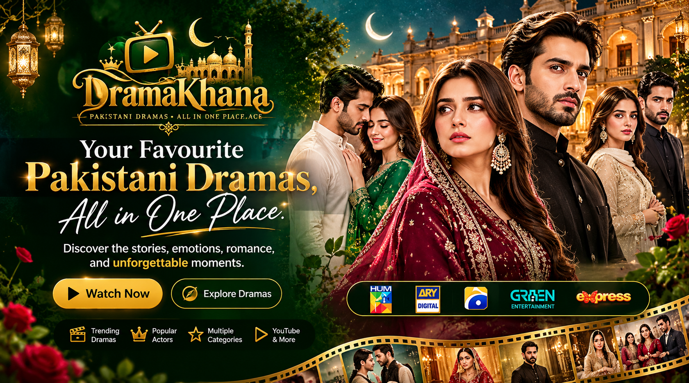

# DramaKhana (ڈراما خانہ) — Premium Pakistani Drama Streaming Platform

> A modern, cinematic streaming web application dedicated to Pakistani drama serials, featuring dual streaming architectures (direct YouTube synchronization and high-bitrate self-hosted MP4 uploads), dynamic video hero sections, smart episode progression with next-episode suggestions, 1-click video downloads & watchlist saving, and scroll-activated cinema showcases.

---

## 🌟 Key Highlights & Features

### 🏛️ Cultural Pakistani Aesthetic & UI
- Designed with rich emerald greens (`#087F5B`), Mughal golds (`#D4AF6A`), and midnight slate tones (`#101512`).
- Responsive Netflix-style horizontal carousels with smooth touch and scroll interactions.
- Dynamic genre tagging, episode count tracking, channel filtering, and real-time search.
- **Scroll-Activated Video Showcase (`3rd.mp4`)**: Smooth IntersectionObserver showcase right before the Romantic Dramas section that plays only when in view and pauses when scrolled away.

### 🎬 Next-Episode Suggestions & Easy Video Download
- **Smart Next Episode Rail**: Watch page automatically detects the current episode and suggests the next episode with thumbnail, duration, and one-click play.
- **Easy Video Downloads**: 1-click instant downloads for direct video streams (MP4) and full 1080p artwork thumbnails, plus official broadcast source streams.
- **Instant Watchlist**: Save and bookmark any Pakistani drama serial or episode with real-time feedback.

### 🛡️ Dual-Database Persistence & Cloud Sync
- **Local SQLite Engine (`better-sqlite3`)**: Zero-latency offline and local development with WAL mode and automatic schema migrations.
- **MongoDB Atlas Cloud Sync (`mongoose`)**: Bidirectional cloud synchronization for users, dramas, episodes, categories, and watch history.
- **Secure Authentication**: JWT-based authentication with bcrypt password hashing and role-based permissions (`admin` / `viewer`).

### ⚙️ Admin Control Center
- Upload own MP4 videos and artwork posters.
- Fetch single videos or full playlists automatically from YouTube.
- Manage drama serials, channel profiles, actor biographies, and category classifications.
- Real-time library analytics, view counts, and breakdown metrics.

---

## 🛠️ Tech Stack

| Layer | Technologies |
|---|---|
| **Frontend** | React 19, TypeScript, Vite, Tailwind CSS v4, Lucide React, Motion |
| **Backend** | Node.js, Express, TSX (TypeScript Execute) |
| **Databases** | MongoDB Atlas (Mongoose) + Local SQLite (better-sqlite3) |
| **Media & Storage** | Native HTML5 Video, Multer, Express Static with HTTP Range support |
| **Auth & Security** | JSON Web Tokens (JWT), Bcrypt.js, protected route middleware |
| **Deployment** | Vercel (`vercel.json`) & GitHub |

---

## 🚀 Quick Start & Installation

### 1. Clone the Repository
```bash
git clone https://github.com/jasminaramim/DramaKhana.git
cd DramaKhana
```

### 2. Install Dependencies
```bash
npm install
```

### 3. Launch Development Server
```bash
npm run dev
```

Open your browser and navigate to:
```
http://localhost:3000
```

### 4. Build for Production / Deployment
```bash
npm run build
```

---

## 📜 Scripts Reference

- `npm run dev` — Starts the Express backend and Vite client in integrated development mode (`http://localhost:3000`).
- `npm run build` — Compiles and optimizes client-side assets into `dist/`.
- `npm run preview` — Previews the production build locally.

---

## 🌐 Live Deployment

- **Platform**: Vercel
- **Project Name**: DramaKhana
- **Developer**: Jasmin ([Jasmin Portfolio](https://jasmin-v01.vercel.app/))
